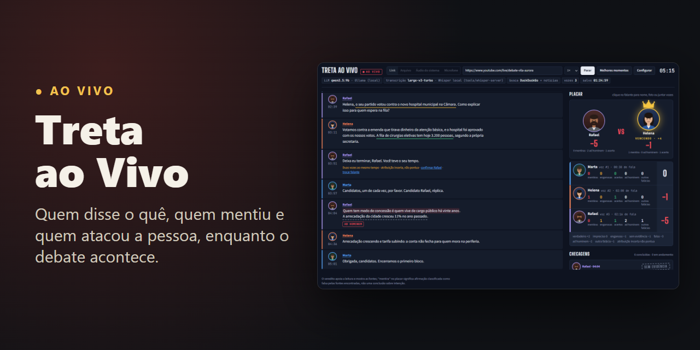
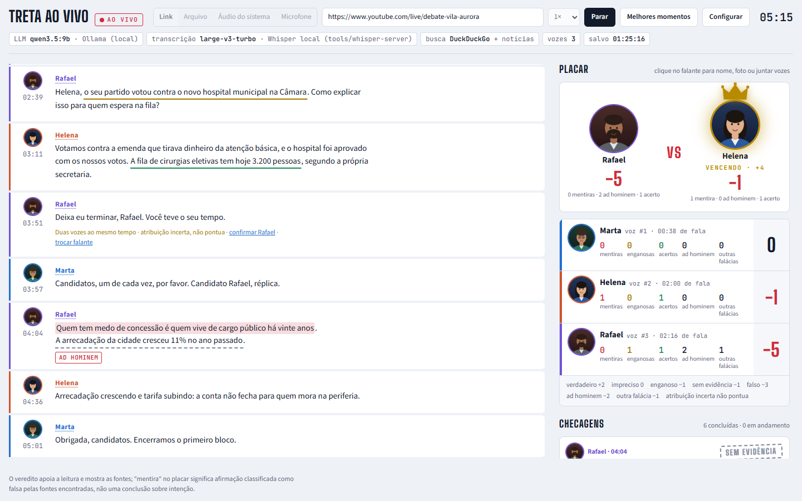
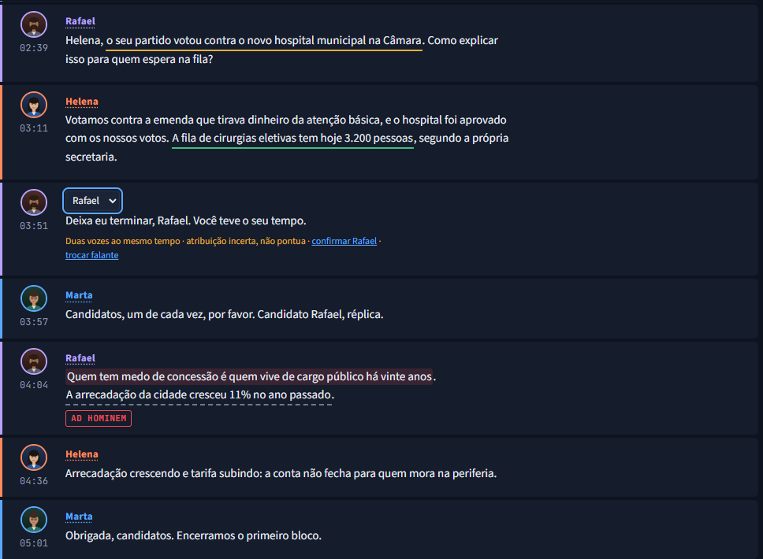
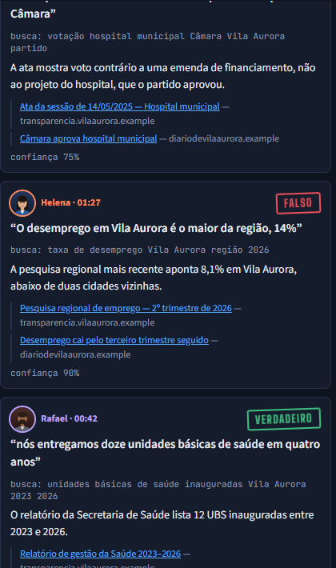
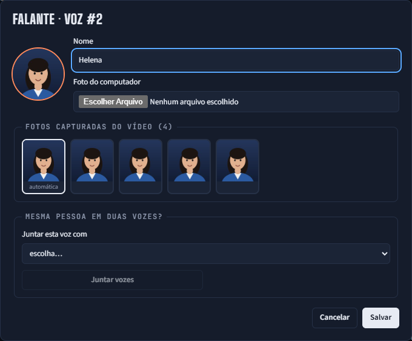
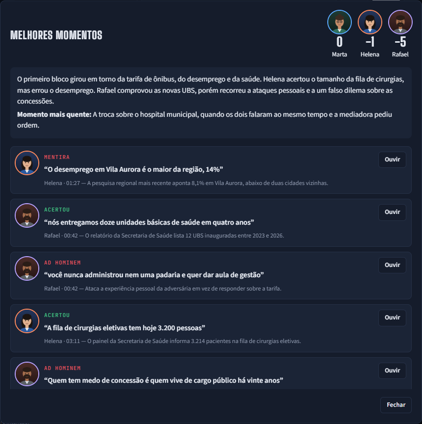
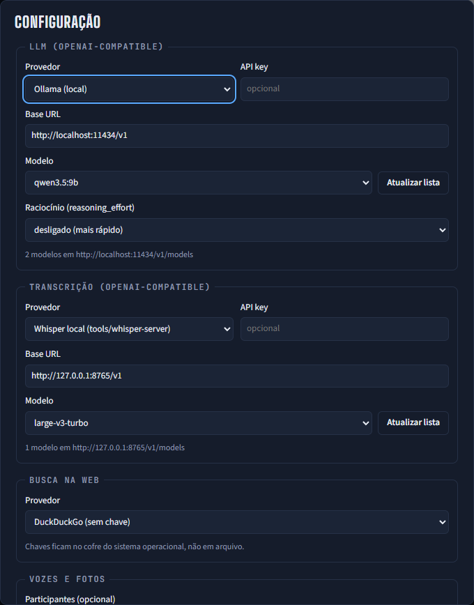
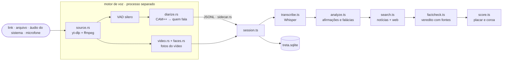

<div align="center">



# Treta ao Vivo

**Acompanhe um debate ao vivo sabendo quem disse o quê, quem errou e quem partiu para o ataque pessoal.**<br/>
Transcreve em tempo real, separa os falantes pela voz, checa afirmações em notícias e na web e mantém um placar com fontes.

[](https://github.com/juninmd/treta-aovivo/actions/workflows/ci.yml)


[Tour](#tour) · [Rodar](#rodar) · [Numa live](#numa-live) · [Como funciona](#como-funciona) · [Configuração](#configuração) · [Desenvolvimento](#desenvolvimento) · [Limitações](#limitações) · [Problemas comuns](#problemas-comuns)

<br/>

<picture>
  <source media="(prefers-color-scheme: dark)" srcset=".github/assets/screenshots/home-dark.png" />
  
</picture>

</div>

> **Cole o link do debate, clique em Iniciar e veja o placar se formar enquanto as pessoas falam.**
> Com Ollama e o Whisper local, áudio e transcrição ficam na sua máquina; só as buscas de checagem vão para a web.

## Por que Treta ao Vivo

O escopo é um só: **acompanhar um debate enquanto ele acontece**. Não edita vídeo, não publica nada e não decide intenção de ninguém.

🎙️ **Quem fala, pela voz.** Um motor em Rust (sherpa-onnx, CAM++) agrupa as vozes em tempo real e tira as fotos do próprio vídeo.

🔎 **Checagem com fonte.** Cada afirmação verificável vira busca em notícias datadas e na web; o veredito mostra a consulta, a explicação e os links.

⚖️ **Placar que não chuta.** Fala sobreposta, quem chama o próprio nome e voz que quase não falou ficam como atribuição incerta e não pontuam até alguém revisar.

💾 **Nada se perde.** O debate vai para um SQLite a cada 4 s; se o app fechar, perde segundos, não o debate.

🔌 **Seu provedor.** LLM, transcrição e busca são escolhidos na tela, a partir de `/v1/models`; nada fixo no código.

## Tour

<table>
<tr>
<td width="50%"><br/><b>Revisão de quem falou</b> &ndash; fala sobreposta sai marcada e fora do placar; um clique no nome corrige e o turno passa a contar.</td>
<td width="50%"><br/><b>Checagens com fontes</b> &ndash; veredito, consulta feita, explicação e links datados, com a confiança do julgamento.</td>
</tr>
<tr>
<td width="50%"><br/><b>Falante</b> &ndash; nome, foto escolhida entre as capturas do vídeo e <i>juntar vozes</i> quando a mesma pessoa virou duas.</td>
<td width="50%"><br/><b>Melhores momentos</b> &ndash; pódio, resumo do debate e os trechos decisivos com o áudio original para ouvir de novo.</td>
</tr>
</table>

<details>
<summary>🖥️ Mais telas: configuração</summary>



</details>

<sub>Prints gerados por <code>pnpm screenshots</code>: a interface real contra um backend simulado, com um debate fictício (Vila Aurora). Nenhuma pessoa real aparece.</sub>

## Rodar

Requisitos: Windows 11, Node 22+, pnpm 10, Rust estável, `ffmpeg` e `yt-dlp` no PATH, um LLM OpenAI-compatible (Ollama, LiteLLM, OpenRouter, OpenAI, Groq…) e, para o Whisper local, GPU NVIDIA + [uv](https://docs.astral.sh/uv/).

```sh
pnpm install
pnpm whisper:local        # outro terminal: Whisper large-v3-turbo em 127.0.0.1:8765
pnpm tauri dev
```

Em **Configurar**, escolha provedor e modelo de LLM, transcrição e busca. As chaves ficam no cofre de credenciais do sistema, nunca no `localStorage`.

> [!NOTE]
> Ainda não há instalador: o app roda a partir do código e só foi homologado no Windows 11. Na primeira sessão o motor baixa os modelos de voz (≈30 MB com o padrão CAM++, sha256 verificado) para a pasta de dados do app.

## Numa live

1. **Configurar → Participantes:** `Helena Prado; Rafael Lima; Marta Souza` (ajuda a nomear as vozes).
2. **Link** com a URL da live do YouTube e velocidade **1×** → **Iniciar**. O áudio começa entre 3 e 30 s; se demorar, aparece "A fonte não envia áudio há 15 s".
3. Transmissão fora do YouTube (Globoplay, site da emissora): toque no navegador e use **Áudio do sistema**. Não há vídeo nesse modo, então escolha as fotos no diálogo do falante.
4. Clique num falante para corrigir nome, escolher foto ou **juntar vozes**. Clique no nome de um turno para dizer quem realmente falou.
5. **Melhores momentos** ao final: pódio, resumo e trechos com áudio.

Recomendado: LLM sem raciocínio estendido para acompanhar o ritmo (Ollama `qwen3.5:9b` com `reasoning_effort: none` responde em ~0,7 s).

## Como funciona



- **Motor em processo separado.** Com pouca memória o onnxruntime aborta o processo inteiro; cai o motor, não a janela, e a transcrição até ali fica. Só um motor roda por vez, mesmo com cliques repetidos em Iniciar.
- **Prazo em cada chamada.** Transcrição (60 s), LLM (90 s), busca (45 s) e nomes (120 s) têm limite próprio: provedor travado vira erro visível, não fila parada.
- **Citação conferida.** O LLM devolve o trecho citado e o app o procura no texto original: afirmação que não bate com o que foi dito e falácia sem trecho literal são descartadas.
- **Incerteza não pontua.** Duas vozes juntas, quem chama o próprio nome e voz com menos de 10 s de fala ficam marcadas até alguém revisar.
- **Nomes conferidos.** O palpite vem da fala (cumprimentos, quem é chamado antes de responder) e é checado: quem chama "Helena" pelo nome não pode ser a Helena.
- **Fotos estáveis.** O motor recorta o rosto que domina a cena durante falas longas; a foto automática só aparece com 3+ capturas, então corte de câmera não vira foto errada.
- **Placar:** verdadeiro +2, impreciso 0, enganoso −1, sem evidência −1, falso −3, ad hominem −2, outra falácia −1. O líder do duelo ganha a coroa, que cai de novo quando a liderança muda.

## Configuração

No app, tudo é escolhido em **Configurar**. Sem interface, a homologação (`pnpm homologate`) e o motor leem estas variáveis:

| Variável | Para quê | Padrão | Exemplo |
|---|---|---|---|
| `LLM_BASE_URL` / `LLM_MODEL` / `LLM_API_KEY` | LLM OpenAI-compatible | `http://localhost:11434/v1` / primeiro listado / — | `qwen3.5:9b` |
| `LLM_REASONING` | `reasoning_effort` enviado ao LLM | `none` | `low` |
| `ASR_BASE_URL` / `ASR_MODEL` / `ASR_API_KEY` | transcrição OpenAI-compatible | `http://127.0.0.1:8765/v1` / primeiro listado / — | `large-v3-turbo` |
| `SEARCH` | provedor de busca | `duckduckgo` | `serper` |
| `GOOGLE_API_KEY` + `GOOGLE_CSE_ID` / `SERPER_API_KEY` | chaves do Google Custom Search / Serper | — | — |
| `VOICE_MODEL` / `VOICE_THRESHOLD` | modelo de voz e limiar de agrupamento | `3dspeaker-campplus` / `0.55` | `0.6` |
| `PARTICIPANTS` | nomes esperados, separados por `;` | vazio | `Helena Prado; Rafael Lima` |
| `TRETA_MODELS_DIR` | pasta dos modelos de voz (app e testes `--ignored`) | pasta de dados do app | `D:\modelos\treta` |

```sh
LLM_MODEL=qwen3.5:9b pnpm homologate --speed 2                       # vídeo de referência
PARTICIPANTS="Helena Prado; Rafael Lima" pnpm homologate --url <link> --speed 1
pnpm homologate --file debate.mp4 --limit-seconds 300
```

A homologação roda o mesmo pipeline do app sem interface e gera `homologation/report.md` (+ `report.json` e fotos).

## Desenvolvimento

```sh
pnpm install                                # dependências
pnpm typecheck                              # tipos do app e dos scripts
pnpm test                                   # core, sessão, provedores e busca (Vitest)
pnpm build                                  # frontend em dist/
pnpm tauri dev                              # app com hot reload
pnpm screenshots                            # regenera .github/assets com a UI real e dados fictícios (usa Edge ou Chrome)
cd src-tauri && cargo test --lib            # motor: clusters, sobreposição, vídeo, protocolo
cargo clippy --all-targets -- -D warnings   # lint do motor, o mesmo da CI
cargo test --lib -- --ignored               # exige modelos (TRETA_MODELS_DIR) e TRETA_FACE_SAMPLE
```

`treta-engine` (`src-tauri/src/bin`) é o motor em linha de comando: imprime os mesmos eventos JSONL que o app recebe.

## Contribuindo

Commits seguem [Conventional Commits](https://www.conventionalcommits.org/) (`fix:`, `feat:`, `docs:`…). Correção de bug chega com um teste que falhava antes dela. A CI roda typecheck, testes e build do frontend, e clippy e testes do motor no Windows; um PR deve estar com a CI verde antes do merge.

## Segurança

| Camada | Proteção |
|---|---|
| Comandos do app | a webview só chama os 8 comandos do app listados em `src-tauri/capabilities/default.json`; abrir link aceita só http(s) |
| Página | CSP sem plugins, frames, `base-uri` nem envio de formulário |
| Chaves | cofre de credenciais do sistema, com lista fixa de 4 nomes; a chave do Google não aparece em mensagem de erro |
| Whisper local | escuta só em 127.0.0.1 e recusa `Host` diferente ou `Origin` que não seja o app, então uma página aberta no navegador não usa sua GPU |
| Fontes de mídia | link só http(s) e sem argumentos extras para o `yt-dlp`; arquivo precisa existir e o `ffmpeg` só lê arquivo e pipe |
| Busca | resposta com tamanho máximo; links de resultado só http(s) |
| Modelos | download com sha256 verificado |

## Limitações

- Homologado só no Windows 11; macOS e Linux não foram testados.
- Duas pessoas falando ao mesmo tempo não têm atribuição confiável; esses turnos ficam marcados e fora do placar.
- Voz com menos de 10 s de fala não pontua: costuma ser pedaço de outra voz. Pontua quando falar mais ou quando alguém confirmar.
- O veredito depende das fontes encontradas. "Mentira" no placar significa afirmação classificada como falsa pelas fontes, não uma conclusão sobre intenção.
- O DuckDuckGo pode limitar buscas em sequência; Google Custom Search ou Serper (com chave) são mais estáveis.
- Mesma pessoa em duas vozes acontece quando a voz muda muito (grito, microfone); use "juntar vozes".
- Em **Áudio do sistema** e **Microfone** não há vídeo, então não há foto automática.

## Problemas comuns

| Sintoma | Causa e saída |
|---|---|
| "O motor de voz caiu (0xC0000409)" | Faltou memória e o onnxruntime abortou. O motor roda em processo separado, então a transcrição fica; feche programas pesados e inicie de novo. |
| "o provedor não respondeu a tempo" | O LLM, a transcrição ou a busca passou do prazo. Confira se o Ollama e o Whisper estão de pé; aquela fala fica sem análise e as seguintes continuam normalmente. |
| Checagens com "DuckDuckGo recusou a busca" | Limite do DuckDuckGo (o app espera e tenta de novo; as notícias seguem valendo). Para uma live longa, use Google ou Serper com chave. |
| Onde ficam os debates salvos | `%APPDATA%\dev.juninmd.treta-aovivo\treta.sqlite` (tabelas `debates`, `speakers`, `utterances`, `claims`, `fallacies`); passe o mouse no chip "salvo" para ver o caminho. |
| Build Rust muito lento no Windows | O antivírus escaneia `target/` e o cache de build; uma exclusão dessas pastas é decisão de quem administra a máquina. |
| Nomes "Falante N" | Preencha Participantes ou renomeie clicando no falante; o app tenta de novo a cada 20 turnos. |

## Licença

Ainda sem licença definida: até que uma seja escolhida, todos os direitos ficam com o autor.

<div align="center"><sub>Feito com Tauri, React, AI SDK e sherpa-onnx para acompanhar debates enquanto eles acontecem.</sub></div>
